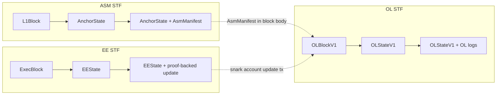

# Architecture

Alpen is a Bitcoin layer 2 split into three state machines. Each one is a state transition
function (STF) that runs natively in a node and inside a zkVM for proofs:

- The **Anchor State Machine (ASM)** reads Bitcoin blocks, picks out the transactions tagged
  for Strata, and emits a manifest of logs per block. It lives in
  [alpenlabs/asm](https://github.com/alpenlabs/asm).
- The **Orchestration Layer (OL)** runs the L2 chain: accounts, messages, epochs, and
  checkpoints. It reads the ASM manifests and posts a proven checkpoint to Bitcoin for each
  epoch. It lives in this repository.
- The **Execution Environment (EE)** runs any OL's Snark Account such as the `alpen` EVM. It lives in
  [alpenlabs/alpen-ee](https://github.com/alpenlabs/alpen-ee).



- **ASM STF**: `AnchorState + L1Block → (AnchorState', AsmManifest)`
- **OL STF**: `OLStateV1 + OLBlockV1 + OLRuntimeParams → (OLStateV1', OL logs)`
- **EE STF**: `EEState + ExecBlock → (EEState', proof-backed account update)`

The EE names are conceptual. To the OL, the EE is one snark account: its state, inbox, and
predicate live in `OLSnarkAccountStateV1`, and the EE moves it forward with proof-backed
snark account update transactions that the OL STF checks against the predicate. This
repository has no EVM or Reth code.

## Bitcoin and the ASM

Bitcoin is the source of truth and the data availability layer. Protocol transactions carry
an SPS-50 header (magic, subprotocol ID, transaction type) in their first output, and large
payloads go in SPS-51 envelopes: a commit transaction and reveal transactions that carry the
data in taproot witnesses.

The node embeds the ASM worker from the pinned `strata-asm-*` crates and runs it over every
L1 block. The current ASM spec, `StrataAsmSpecV1` (spec 1), runs three subprotocols in this
order:

| ID | Subprotocol | Role |
| --- | --- | --- |
| 0 | Admin | Multisig governance and upgrades, including new checkpoint predicates |
| 1 | Checkpoint | Verifies OL checkpoints and tracks the verified tip |
| 2 | Bridge (`BridgeSubprotoV2`) | Deposits, operators, withdrawal assignments, and `OperatorClaimUnlockV1` export leaves |

The ASM execution parameters, a JSON file distributed with the network parameters and named
by `asm_execution` in the node config, map each predicate to the ASM spec that runs under it.
Functional tests create deposits through the bridge.

The OL reads the ASM through its manifests and logs. The ASM's own design is in the asm
repository's [`docs/`](https://github.com/alpenlabs/asm/tree/main/docs).

## OL blocks and epochs

An `OLBlockV1` ([`crates/ol/chain-types-v1/ssz/block.ssz`](../crates/ol/chain-types-v1/ssz/block.ssz))
is a signed header and a body. The header commits to the slot, epoch, parent, body root,
state root, and logs root. The body has two optional parts:

- a transaction segment of `OLTransactionV1`s
  ([`crates/ol/tx-types-v1`](../crates/ol/tx-types-v1)): generic account messages and snark
  account updates, and
- the ASM manifests for the L1 blocks the chain has not yet included.

A block may carry manifests anywhere in an epoch. Their logs are buffered and processed at
the epoch's terminal block, which the `IS_TERMINAL` header flag marks. The terminal block
ends the epoch: the STF processes the buffered ASM logs (deposits, predicate updates, and so
on), and the epoch becomes a checkpoint. A checkpoint commits to the epoch's terminal header,
its DA diff, its logs, and the manifests it read.

The OL STF has one entry point, [`crates/ol/stf`](../crates/ol/stf), which takes the
`OLSpecId` of the epoch being executed and dispatches to that spec's rules. Every driver goes
through it: block verification, block assembly and the mempool, the checkpoint proof, DA
replay and DA computation, and genesis. Outside `ol/stf`, only tests and the prover
benchmark's fixtures call [`crates/ol/stf-v1`](../crates/ol/stf-v1) directly.
[ol-specs.md](ol-specs.md) covers spec selection, the state root, and how to add a spec.

## Accounts

The OL state holds ledger accounts. Each has a balance and is either empty or a snark
account. Snark accounts act like actors: other accounts send them messages, which land in an
inbox MMR, and the account's owner advances it with an update that proves it processed those
messages. Deposits arrive as ASM bridge logs and credit an account. A withdrawal is a message
to the bridge gateway account, which the STF turns into a withdrawal log. The types live in
[`crates/acct-types`](../crates/acct-types), [`crates/snark-acct-types`](../crates/snark-acct-types),
and [`crates/ol/msg-types`](../crates/ol/msg-types); the update rules in
[`crates/snark-acct-sys`](../crates/snark-acct-sys).

## Runtime

`strata` ([`bin/strata`](../bin/strata)) is the node. It has two roles. A **sequencer** builds
blocks and posts checkpoints. A **full node** follows the chain from checkpoints on L1.
[`services.rs`](../bin/strata/src/services.rs) wires the services together:

```text
bitcoind ──▶ btcio reader ──▶ ASM worker ──▶ CSM worker ──┬──▶ fork choice (sequencer)
                                                          └──▶ checkpoint sync (full node)
                                                                         │
                                                                         ▼
                                                                    chain worker ──▶ OL state

sequencer only:
mempool ──▶ block assembly ──▶ signer duties ──▶ fork choice
checkpoint builder ──▶ prover ──▶ btcio writer ──▶ broadcaster ──▶ bitcoind
```

- **btcio reader** ([`crates/btcio`](../crates/btcio)) polls `bitcoind` and hands each L1
  block to the ASM worker. It starts before genesis, since genesis needs the ASM's genesis
  manifest.
- **ASM worker** runs the ASM STF per L1 block and stores anchor states and manifests. Its
  context comes from [`crates/consensus-logic`](../crates/consensus-logic).
- **CSM worker** ([`crates/csm-worker`](../crates/csm-worker)) follows the ASM worker, reads
  the checkpoint subprotocol's logs, and keeps the client state: which epochs L1 has
  confirmed and finalized.
- **Chain worker** ([`crates/chain-worker`](../crates/chain-worker)) executes OL blocks
  through the STF, applies and finalizes epochs, and persists the resulting state.
- **Fork choice** (sequencer) tracks the unfinalized block tree, picks the tip, and finalizes
  epochs as the CSM reports them. **Checkpoint sync** (full node) rebuilds each finalized
  epoch's state from the DA diff in its L1 checkpoint. A node runs exactly one of the two;
  both are in [`crates/consensus-logic`](../crates/consensus-logic).
- **Mempool** and **block assembly** ([`crates/ol/mempool`](../crates/ol/mempool),
  [`crates/ol/block-assembly`](../crates/ol/block-assembly)) admit transactions and build
  block templates. A sealing policy decides when a block ends the epoch.
- **Signer duties** ([`crates/ol/sequencer`](../crates/ol/sequencer)) expose what needs a
  signature: block templates, checkpoints, and envelope reveal transactions. The detached
  `strata-signer` ([`bin/strata-signer`](../bin/strata-signer)) polls the sequencer RPC for
  duties, signs them, and posts the results back, so the private keys stay in the signer.
- **Checkpoint builder** ([`crates/ol/checkpoint`](../crates/ol/checkpoint)) builds a
  checkpoint for each finished epoch and waits for its proof. Its submission tracker reports
  checkpoints that were mined on L1 but rejected by the ASM.
- **Prover** ([`bin/strata/src/prover`](../bin/strata/src/prover)) proves checkpoints
  in-process when the binary has the `prover` feature and the config has a `[prover]`
  section. Without one, checkpoints carry empty proofs, which only an `AlwaysAccept`
  predicate accepts.
- **btcio writer and broadcaster** wrap payloads in envelopes, publish them, bump fees, and
  track them to confirmation. EE DA payloads use SPS-51 chunked envelopes: one commit
  transaction with a compact `OP_RETURN` funds several reveals. The EE builds the payload;
  this repository publishes and tracks it.
- **RPC** ([`bin/strata/src/rpc`](../bin/strata/src/rpc)) serves the OL JSON-RPC API defined
  in [`crates/ol/rpc/api`](../crates/ol/rpc/api).

The services own their state and take their dependencies through context traits. The binary
supplies the sled and `bitcoind` implementations.

### Checkpoint lifecycle

1. The chain worker executes the epoch's terminal block.
2. The checkpoint builder computes the epoch's DA diff and builds the checkpoint.
3. The prover proves it with the checkpoint program for the epoch's spec.
4. The signer acknowledges the checkpoint duty, and the node wraps the checkpoint in an
   envelope. The signer then signs the envelope's reveal transaction with the sequencer key
   recorded in the ASM checkpoint state.
5. The broadcaster publishes the envelope.
6. The ASM checkpoint subprotocol checks the envelope's key against the sequencer key and the
   proof against the checkpoint predicate, then emits logs.
7. The CSM worker reads those logs and updates the client state. Fork choice or checkpoint
   sync finalizes the epoch once its L1 block is buried deep enough.

## Storage

The node keeps one sled database ([`crates/db/store-sled`](../crates/db/store-sled)), opened
in [`bin/strata/src/init_db.rs`](../bin/strata/src/init_db.rs). It holds L1 blocks, ASM
states and manifests, the client state, OL blocks and states, checkpoints, the MMR index,
mempool entries, writer and broadcaster entries, and prover tasks. The traits are in
[`crates/db/types`](../crates/db/types), and [`crates/storage`](../crates/storage) wraps them
in cached managers behind `NodeStorage`.

OL states are stored as `OLStateContainer`s, which pair the state root fields with the
chainstate's SSZ bytes; see [ol-specs.md](ol-specs.md#state-root).
[`bin/strata-dbtool`](../bin/strata-dbtool/README.md) reads and repairs the database offline.

## Proofs

The checkpoint proof runs the OL STF over one epoch inside SP1.
[`crates/proof-impl/checkpoint`](../crates/proof-impl/checkpoint) defines the statement, and
[`provers/sp1`](../provers/sp1/README.md) builds the guest, which proves one fixed spec. The
guest embeds the `OLRuntimeParams`, so its verifying key commits to them. Earlier specs keep
the bundle published for them; [`crates/ol/checkpoint-artifacts`](../crates/ol/checkpoint-artifacts/README.md)
loads one bundle per spec. [`crates/prover-core`](../crates/prover-core/README.md) and
[`crates/paas`](../crates/paas/README.md) run the proving jobs.

## Parameters and configuration

Configuration is split by owner:

- **ASM parameters** (`AsmParams`, `--asm-params`): the L1 anchor, network, magic bytes, and
  subprotocol genesis config.
- **OL parameters** (`OLParams`, `--ol-params`): `OLGenesisParams`, including the network's
  genesis spec, and `OLRuntimeParams`. Real guest builds embed the runtime parameters, so
  changing them changes the checkpoint verifying key.
- **Node configuration** (TOML, [`crates/config`](../crates/config); see
  [`example_config.toml`](../example_config.toml)): operational settings such as `bitcoind`,
  btcio fees and reorg depth, the sequencer, and the prover.

`strata-datatool gen-asm-params` and `gen-ol-params` generate the parameter files; see
[`bin/datatool`](../bin/datatool/README.md). At startup, `strata` rejects ASM and OL
parameters whose bridge denomination, genesis L1 block, or genesis OL block disagree.

## Specifications

The design is specified in the Strata Protocol Specifications (SPS), indexed in the team
Notion workspace:

| Spec | Name | Description |
| --- | --- | --- |
| SPS-50 | L1 Transaction Header | `OP_RETURN` format for protocol transactions |
| SPS-51 | Generic Envelope Format | Bitcoin envelope format for protocol transactions |
| SPS-60 | Moho Proof Mechanism | Upgradeable proof wrapper for the ASM |
| SPS-61 | ASM Core Types | ASM state structure and lifecycle |
| SPS-62 | OL Checkpoint Structure | Checkpoint format and verification |
| SPS-63 | OL Checkpointing Subprotocol | Checkpoint processing in the ASM |
| SPS-64 | Bridge Subprotocol | Deposits, withdrawals, and operators |
| SPS-ol-stf | Orchestration Layer STF | The OL state transition function |
| SPS-acct-sys | Account System | Ledger and system accounts |
| SPS-snark-acct | Snark Accounts | Actor-like accounts with proven updates |
| SPS-ol-chain-structures | Chain Structures | OL block and transaction types |
| SPS-ol-da-primitives | DA Primitives | OL data availability primitives |
| SPS-ol-da-structure | DA Structure | OL data availability structure |
