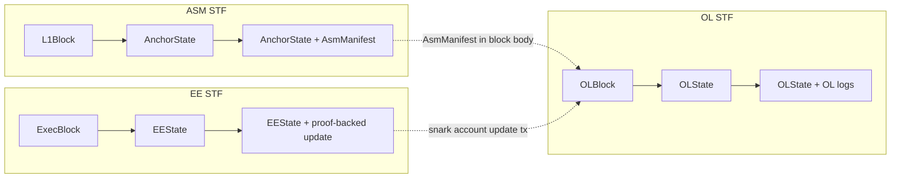

# Architecture

Strata is a blockchain that settles on Bitcoin. It works as a rollup: a sequencer builds
blocks off Bitcoin, and for each epoch it posts a zero-knowledge proven checkpoint of the
chain to Bitcoin, where anyone can verify it.

Strata is split into two state machines. Each one includes a state transition function (STF)
that runs natively in a node and inside a zkVM for proofs:

- The **Anchor State Machine (ASM)** reads Bitcoin blocks, picks out the transactions tagged
  for Strata (bridge, governance and checkpoint transactions) and emits a manifest of logs per
  block. It verifies the checkpoints posted to Bitcoin. It lives in
  [alpenlabs/asm](https://github.com/alpenlabs/asm).
- The **Orchestration Layer (OL)** runs the chain: accounts, messages, blocks and
  checkpoints. It reads the ASM manifests and posts a checkpoint to Bitcoin for each epoch.
  It lives in this repository.

Applications run on the OL as [snark accounts](#accounts). An **Execution Environment (EE)**,
such as the EVM, is one such application: it runs its own state machine outside Strata and
moves its account forward with proof-backed updates that the OL STF checks against the
account's predicate.



- **ASM STF**: `AnchorState + L1Block → (AnchorState', AsmManifest)`
- **OL STF**: `OLState + OLBlock + OLRuntimeParams → (OLState', OL logs)`
- **EE STF**: `EEState + ExecBlock → (EEState', proof-backed account update)`

Bitcoin is the source of truth and the data availability layer; the ASM that reads it is
described in the asm repository's [`docs/`](https://github.com/alpenlabs/asm/tree/main/docs).

## Accounts

The OL state holds ledger accounts. Each has a balance and is either empty or a snark
account.

A **snark account** changes state only through updates that carry a proof. The account stores
a predicate, the verifying key for its update proofs. The OL STF applies an update only if the
predicate accepts the update's proof. Other accounts send it messages, which land in its inbox
MMR, and each update proves which of those messages it processed, in order.

Some account IDs are reserved for the protocol, and no ledger account can occupy them. The
**bridge gateway** is one: the STF handles messages sent to it and turns valid ones into
withdrawal logs. The admin message ID is another: it is the sender of the system messages that
admin actions produce, such as predicate key rotations.

Deposits arrive as ASM bridge logs and credit an account. The types live in [`crates/acct-types`](../crates/acct-types),
[`crates/snark-acct-types`](../crates/snark-acct-types) and
[`crates/ol/msg-types`](../crates/ol/msg-types); the update rules in
[`crates/snark-acct-sys`](../crates/snark-acct-sys).

## OL blocks and epochs

An OL block is a signed header and a body. The header commits to the slot, epoch, parent,
body root, state root and logs root. The body has two optional parts: a transaction segment
(account messages and snark account updates) and the ASM manifests for the L1 blocks the chain
has not yet included.

An epoch ends with a _terminal_ block. On a terminal block, the STF processes the logs of
the manifests the epoch included (deposits, predicate updates and so on), and the sequencer
then builds a checkpoint for the epoch.

The word checkpoint covers two things. The **checkpoint payload** is what the sequencer posts
to Bitcoin: the new tip (epoch, L1 height and terminal block), the proof and a sidecar with the
epoch's DA diff, its logs and the terminal header fields L1 does not already have. The
**checkpoint claim** is what the proof commits to. It names the epoch, its block range and the
manifests the epoch included, and it holds hashes of the DA diff, the logs and those header
fields. The ASM rebuilds the claim from the payload and the state it already holds, then
verifies the proof against it. The payloads on Bitcoin and the ASM manifests are enough for
anyone to rebuild the OL state and continue the chain.

The OL STF has one entry point, [`crates/ol/stf`](../crates/ol/stf), which takes the
`OLSpecId` of the epoch being executed and dispatches to that spec's rules. Everything that
executes OL blocks goes through it. [ol-specs.md](ol-specs.md) covers spec selection, the
state root and how to add a spec.

## Runtime

`strata` ([`bin/strata`](../bin/strata)) is the node. A node runs in one of two roles. A
**sequencer** builds blocks and posts checkpoints. A **full node** follows the chain from
checkpoints on L1.
[`services.rs`](../bin/strata/src/services.rs) wires the services together:

```text
bitcoind ──▶ btcio reader ──▶ ASM worker ──▶ CSM worker ──┬──▶ fork choice (sequencer)
                                                          └──▶ checkpoint sync (full node)
                                                                         │
                                                                         ▼
                                                                    chain worker ──▶ OL state

sequencer only:
mempool ──▶ block assembly ──▶ signer duties ──▶ fork choice
checkpoint builder ──▶ prover ──▶ btcio writer ──▶ broadcaster ──▶ bitcoind
```

- **btcio reader** ([`crates/btcio`](../crates/btcio)) polls `bitcoind` and hands each L1
  block to the ASM worker.
- **ASM worker** runs the ASM STF per L1 block and stores anchor states and manifests. Its
  context comes from [`crates/consensus-logic`](../crates/consensus-logic).
- **CSM worker** ([`crates/csm-worker`](../crates/csm-worker)) runs the Client State Machine
  (CSM). It follows the ASM worker, reads the checkpoint subprotocol's logs and keeps the
  client state: which epochs L1 has confirmed and which are sufficiently buried.
- **Chain worker** ([`crates/chain-worker`](../crates/chain-worker)) executes OL blocks
  through the STF, applies and finalizes epochs, then persists the resulting state.
- **Fork choice** (sequencer only) tracks the unfinalized block tree, picks the tip and
  finalizes epochs as the CSM reports them. A full node runs **checkpoint sync** instead.
  Nodes do not sync blocks between each other yet, so a full node receives no unfinalized
  blocks and has no tips to choose between. Checkpoint sync rebuilds each finalized epoch's
  state from the DA diff in its L1 checkpoint. Both are in
  [`crates/consensus-logic`](../crates/consensus-logic).
- **Mempool** and **block assembly** ([`crates/ol/mempool`](../crates/ol/mempool),
  [`crates/ol/block-assembly`](../crates/ol/block-assembly)) admit transactions and build
  block templates. A sealing policy decides when a block ends the epoch.
- **Signer duties** ([`crates/ol/sequencer`](../crates/ol/sequencer)) expose what needs a
  signature: block templates, checkpoints and envelope reveal transactions. The detached
  `strata-signer` ([`bin/strata-signer`](../bin/strata-signer)) polls the sequencer RPC for
  duties, signs them and posts the results back, so the private keys stay in the signer.
- **Checkpoint builder** ([`crates/ol/checkpoint`](../crates/ol/checkpoint)) builds a
  checkpoint for each finished epoch and waits for its proof. Its submission tracker reports
  checkpoints that were mined on L1 but rejected by the ASM.
- **Prover** ([`bin/strata/src/prover`](../bin/strata/src/prover)) proves checkpoints
  in-process.
- **btcio writer and broadcaster** wrap payloads in envelopes, publish them, bump fees and
  track them to confirmation.
- **RPC** ([`bin/strata/src/rpc`](../bin/strata/src/rpc)) serves the OL JSON-RPC API defined
  in [`crates/ol/rpc/api`](../crates/ol/rpc/api).

The services own their state and take their dependencies through context traits. The binary
supplies the sled and `bitcoind` implementations.

### Checkpoint lifecycle

1. The chain worker executes the epoch's terminal block.
2. The checkpoint builder builds the checkpoint, and the prover proves it.
3. The signer signs the reveal transaction of the envelope that carries it, and the
   broadcaster publishes the envelope.
4. The ASM checkpoint subprotocol checks the signature against the sequencer key and the proof
   against the checkpoint predicate, then emits logs.
5. The CSM worker reads those logs. Fork choice or checkpoint sync finalizes the epoch once
   its L1 block is buried deep enough.

## Storage

The node keeps its state in one sled database
([`crates/db/store-sled`](../crates/db/store-sled)). OL states are stored as
`OLStateContainer`s, which pair the state root fields with the chainstate's SSZ bytes; see
[ol-specs.md](ol-specs.md#state-root).

## Proofs

The checkpoint proof runs the OL STF over one epoch inside SP1.
[`crates/proof-impl/checkpoint`](../crates/proof-impl/checkpoint) defines the statement, and
[`provers/sp1`](../provers/sp1/README.md) builds the guest, which proves one fixed spec. The
guest embeds the `OLRuntimeParams`, so its verifying key commits to them. Earlier specs keep
the bundle published for them; [`crates/ol/checkpoint-artifacts`](../crates/ol/checkpoint-artifacts/README.md)
loads one bundle per spec. [`crates/prover-core`](../crates/prover-core/README.md) and
[`crates/paas`](../crates/paas/README.md) run the proving jobs.

## Parameters and configuration

Configuration is split by owner:

- **ASM parameters** (`AsmParams`, `--asm-params`): the L1 anchor, network, magic bytes and
  subprotocol genesis config.
- **OL parameters** (`OLParams`, `--ol-params`): `OLGenesisParams`, including the network's
  genesis spec, and `OLRuntimeParams`. Real guest builds embed the runtime parameters, so
  changing them changes the checkpoint verifying key.
- **Node configuration** (TOML, [`crates/config`](../crates/config); see
  [`example_config.toml`](../example_config.toml)): operational settings such as `bitcoind`,
  btcio fees and reorg depth, the sequencer and the prover.

`strata-datatool gen-asm-params` and `gen-ol-params` generate the parameter files; see
[`bin/datatool`](../bin/datatool/README.md). At startup, `strata` rejects ASM and OL
parameters whose bridge denomination, genesis L1 block or genesis OL block disagree.
